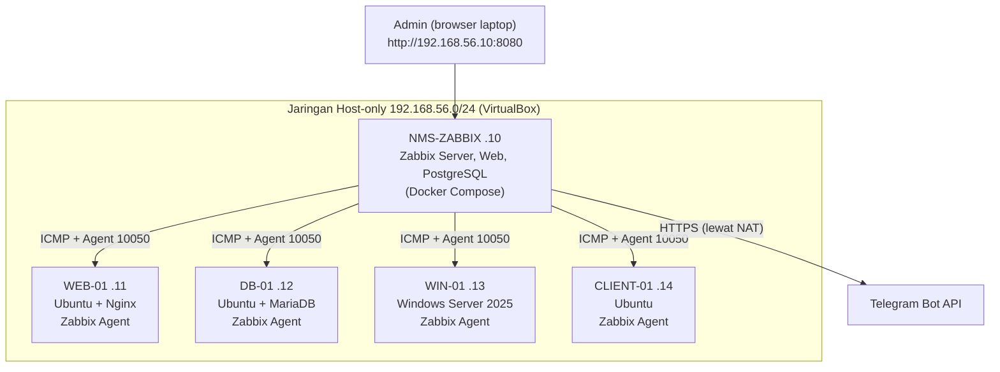
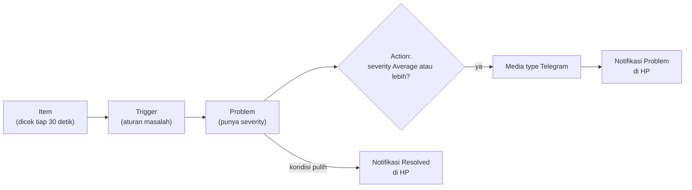
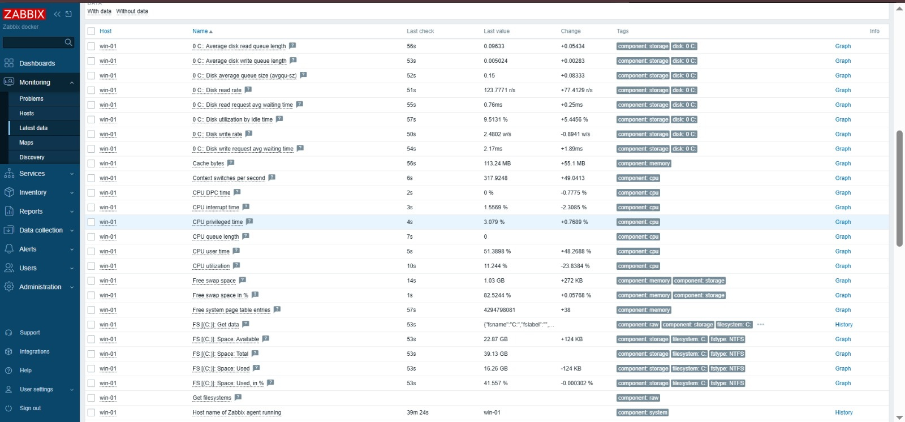
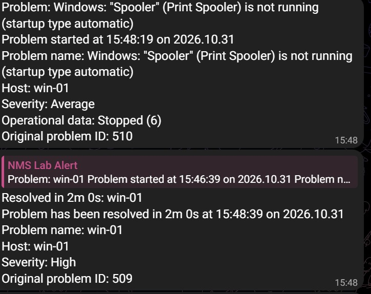
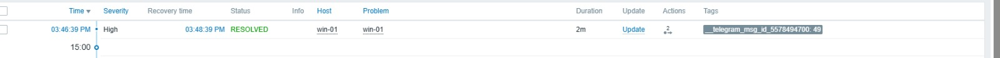

<h1 align="center">Zabbix NMS Lab</h1>
<p align="center"><b>Mini NOC untuk memantau server Linux dan Windows dengan Docker, ICMP, dan alert Telegram</b></p>

<p align="center">
  
  
  
  
  
  
</p>

> Dari VM kosong sampai notifikasi masuk ke HP: membangun, menguji, dan mendokumentasikan sistem monitoring ala NOC. **5 VM, 2 sistem operasi, 8 skenario insiden**, semuanya berjalan di satu laptop.

> **Summary (EN):** A NOC-style monitoring lab. Zabbix 7.0 LTS runs in Docker on one VM and monitors four more VMs (three Ubuntu Server, one Windows Server 2025) using agent checks, ICMP ping, and custom service triggers. Alerts (problem and recovery) are delivered through a Telegram bot. The repo includes a network map, a NOC dashboard, eight documented incident tests with timestamps, and a troubleshooting log.

<p align="center">
  
  
</p>

## Sekilas

| Angka | Keterangan |
|---|---|
| **5 VM** | 1 server monitoring, 3 Ubuntu Server (Nginx, MariaDB, klien), 1 Windows Server 2025 |
| **8 skenario insiden** | Dicatat waktu muncul, waktu pulih, dan durasinya |
| **30 detik** | Interval pengecekan layanan, sehingga layanan mati terdeteksi dalam sekitar 30 detik |
| **3 metode pengecekan** | Zabbix Agent, ICMP ping, dan pengecekan port atau layanan |
| **1 laptop** | Seluruh lab berjalan di Dell Latitude 7390 (Intel Core i7-8650U, RAM 16 GB) |

## Daftar isi

1. [Latar belakang dan tujuan](#latar-belakang-dan-tujuan)
2. [Arsitektur](#arsitektur)
3. [Alur alert](#alur-alert)
4. [Cakupan pemantauan](#cakupan-pemantauan)
5. [Uji insiden](#uji-insiden)
6. [Galeri bukti](#galeri-bukti)
7. [Kendala dan solusi](#kendala-dan-solusi)
8. [Keterampilan yang dilatih](#keterampilan-yang-dilatih)
9. [Keamanan](#keamanan)
10. [Cara mereplikasi](#cara-mereplikasi)
11. [Rencana pengembangan](#rencana-pengembangan)
12. [Penulis](#penulis)

## Latar belakang dan tujuan

Pekerjaan NOC berputar pada satu siklus: **mendeteksi gangguan, memberi tahu orang yang tepat, menganalisis, memulihkan, lalu mendokumentasikan**. Project ini menjalankan seluruh siklus itu dalam skala kecil:

- Memantau ketersediaan dan kinerja server Linux dan Windows di satu jaringan lab.
- Membuat aturan deteksi sendiri (item dan trigger), bukan hanya memakai template bawaan.
- Mengirim notifikasi otomatis (Problem dan Resolved) ke Telegram dengan filter severity.
- Membuktikannya lewat simulasi insiden yang waktunya tercatat.
- Mendokumentasikan kendala nyata dan cara mengatasinya.

## Arsitektur



| VM | Sistem operasi | Peran | IP (Host-only) | RAM | CPU | Disk |
|---|---|---|---|---|---|---|
| NMS-ZABBIX | Ubuntu Server 26.04 LTS | Zabbix Server + Web + PostgreSQL (Docker) | 192.168.56.10 | 3 GB | 2 | 25 GB |
| WEB-01 | Ubuntu Server 26.04 LTS | Web server (Nginx) | 192.168.56.11 | 1 GB | 1 | 25 GB |
| DB-01 | Ubuntu Server 26.04 LTS | Database (MariaDB) | 192.168.56.12 | 1,5 GB | 1 | 25 GB |
| WIN-01 | Windows Server 2025 (Evaluation) | Server Windows | 192.168.56.13 | 3 GB | 2 | 40 GB |
| CLIENT-01 | Ubuntu Server 26.04 LTS | Klien uji | 192.168.56.14 | 1 GB | 1 | 25 GB |

**Desain jaringan:** setiap VM memiliki dua adapter. **NAT** untuk akses internet (unduh paket, Telegram) dan **Host-only** untuk jaringan lab serta akses web Zabbix dari laptop. Ping dilakukan dari **NMS ke tiap VM**, bukan antar sesama VM.

**Teknologi:** Oracle VirtualBox, Ubuntu Server 26.04 LTS, Windows Server 2025, Docker dan Docker Compose, Zabbix 7.0 LTS (7.0.32), PostgreSQL 16, Zabbix Agent (Linux dan Windows), Nginx 1.28, MariaDB 11.8, Telegram Bot API.

## Alur alert



Action memiliki syarat *severity Average atau lebih* supaya peringatan kecil tidak membanjiri notifikasi, dan memiliki *Recovery operation* sehingga pesan **Resolved** ikut terkirim. Zona waktu container Zabbix server disamakan dengan VM (WIB) agar jam pada pesan Telegram sama dengan jam di web Zabbix.

## Cakupan pemantauan

| Aspek | Metode | Trigger | Severity |
|---|---|---|---|
| Ketersediaan host | ICMP Ping dari NMS (template *ICMP Ping*) | Unavailable by ICMP ping (3 ping gagal berturut-turut) | High |
| Latency dan packet loss | ICMP Ping | Trigger bawaan template | Bawaan template |
| Agent | Zabbix Agent (pasif, port 10050) | Zabbix agent is not available (3 menit) | Average |
| Kondisi OS Linux | Template *Linux by Zabbix agent* | Trigger bawaan template | Bawaan template |
| Kondisi OS Windows | Template *Windows by Zabbix agent* | Trigger bawaan template | Bawaan template |
| Layanan Nginx (web-01) | Item `net.tcp.service[http,,80]` tiap 30 detik | **Nginx down** (nilai terakhir = 0) | High |
| Layanan MariaDB (db-01) | Item `net.tcp.port[127.0.0.1,3306]` tiap 30 detik | **MariaDB down** (nilai terakhir = 0) | High |
| CPU web-01 | Item `system.cpu.util` | **High CPU on web-01**: `avg(/web-01/system.cpu.util,#2)>80` | High |
| Layanan Windows (win-01) | Item `service_state[Spooler]` tiap 30 detik | **Print Spooler down on win-01**: `last(...)<>0` | High |

## Uji insiden

Waktu dalam WIB. **Durasi** adalah lama masalah terlihat oleh Zabbix, dihitung dari alert muncul sampai pulih. **Waktu deteksi** bergantung pada interval pengecekan: sekitar 30 detik untuk layanan, dan sekitar 2 sampai 3 menit untuk ICMP karena trigger menunggu 3 kegagalan berturut-turut agar satu paket yang hilang tidak memicu alarm palsu.

| # | Skenario | Host | Alert muncul | Pulih | Durasi | Severity | Notifikasi |
|---|---|---|---|---|---|---|---|
| 1 | `systemctl stop nginx` | web-01 | 29 Okt 18:02:57 | 18:04:27 | 1m 30s | High | Web Zabbix |
| 2 | `systemctl stop mariadb` | db-01 | 29 Okt 18:18:58 | 18:20:28 | 1m 30s | High | Web Zabbix |
| 3 | `systemctl stop nginx` | web-01 | 29 Okt 18:49:27 | 18:50:57 | 1m 30s | High | Telegram |
| 4 | `systemctl stop mariadb` | db-01 | 29 Okt 18:52:28 | 18:54:58 | 2m 30s | High | Telegram |
| 5 | `systemctl stop nginx` | web-01 | 30 Okt 12:40:57 | 12:41:57 | 1m 0s | High | Telegram |
| 6 | VM dimatikan (`poweroff`) | client-01 | 30 Okt 13:00:33 (ICMP) dan 13:01:44 (agent) | 13:07:33 | 7m | High dan Average | Telegram |
| 7 | Beban CPU penuh pada web-01 | web-01 | 30 Okt 13:29:17 | 13:36:17 | 7m | High | Telegram |
| 8 | `Stop-Service Spooler` (Windows) | win-01 | 31 Okt 15:46:39 | 15:48:39 | 2m 0s | High | Telegram |

**Cara membaca:** siklus penanganan diukur lewat dua istilah NOC, yaitu **MTTD** (rata-rata waktu mendeteksi masalah) dan **MTTR** (rata-rata waktu memulihkan). Pada lab ini MTTD layanan sekitar 30 detik, sedangkan MTTR bergantung pada kecepatan pemulihan manual.

## Galeri bukti

### Network map dan dashboard NOC

| Normal | Saat insiden |
|---|---|
|  |  |
|  |  |

<details>
<summary><b>Infrastruktur: VM, jaringan, dan Docker</b> (klik untuk membuka)</summary>


</details>

<details>
<summary><b>Konfigurasi monitoring: item, trigger, dan action</b> (klik untuk membuka)</summary>


</details>

<details>
<summary><b>Alert Telegram</b> (klik untuk membuka)</summary>


</details>

<details>
<summary><b>Riwayat insiden dan grafik</b> (klik untuk membuka)</summary>


</details>

<details>
<summary><b>Windows Server: pemantauan multi-OS</b> (klik untuk membuka)</summary>





</details>

## Kendala dan solusi

Bagian ini sengaja ditulis lengkap karena kemampuan mengurai masalah sama pentingnya dengan hasil akhirnya.

| Kendala | Penyebab | Solusi |
|---|---|---|
| Instalasi Ubuntu Server 26.04 gagal di langkah *installing kernel* (apt exit code 100) | Unduhan paket lewat jaringan NAT gagal | Instal dengan kabel jaringan VM dilepas (kernel diambil dari ISO), jaringan diaktifkan setelah instalasi |
| VM tanpa alamat IPv4 setelah instalasi offline | Tidak ada konfigurasi netplan | Atur IP dengan `netplan set` |
| `netplan apply` menolak file karena indentasi YAML | Kesalahan ketik pada file YAML | Pakai `netplan set` sehingga tidak perlu menulis YAML manual |
| Dua VM berbagi IP setelah *clone* | Clone mewarisi konfigurasi jaringan | Hapus alamat lama, set alamat baru, buat ulang `machine-id` dan kunci SSH host |
| Host "Zabbix server" tidak tersedia | Server berjalan di container, sehingga `127.0.0.1` adalah container itu sendiri | Arahkan interface ke IP VM dan izinkan subnet Docker pada parameter `Server` agent |
| Peringatan SSH *REMOTE HOST IDENTIFICATION HAS CHANGED* | Alamat IP dipakai VM lain | `ssh-keygen -R <ip>` |
| Tes media type Telegram gagal (`event_source`) | Macro tidak terisi di dialog Test | Isi nilai uji manual, lalu uji dengan alert nyata |
| Jam pesan Telegram (UTC) berbeda dari web Zabbix (WIB) | Container server memakai UTC | Ubah zona waktu VM dan mount `/etc/localtime` ke container server |
| `docker compose up` gagal setelah menambah file override | Nama service di file override tidak sama dengan file utama | Cek nama dengan `docker compose config --services` |
| Windows Server tidak menjawab ping | Firewall bawaan memblokir ICMP dan port agent | Buat aturan inbound untuk ICMPv4 Echo dan TCP 10050 lewat PowerShell |
| Peta dan dashboard penuh pemberitahuan *"installed packages has been changed"* | Pemberitahuan rutin template (bukan insiden) setiap paket berubah | Tutup problem tersebut dan saring tampilan berdasarkan severity |

## Keterampilan yang dilatih

| Bidang | Yang dikerjakan |
|---|---|
| Administrasi Linux | Ubuntu Server, netplan, systemd, SSH, clone dan penyesuaian identitas VM |
| Jaringan | Pengalamatan static, NAT dan Host-only, ICMP, pengecekan port dan layanan |
| Container | Docker Compose, volume, jaringan antar container, zona waktu container |
| Monitoring | Zabbix: host, template, item, trigger, map, dashboard, grafik |
| Otomasi alert | Telegram Bot API, filter severity, notifikasi Problem dan Resolved |
| Windows Server | Instalasi, IP static, Remote Desktop, firewall, Zabbix Agent, pemantauan layanan |
| Operasional NOC | Simulasi insiden, pencatatan waktu (MTTD dan MTTR), dokumentasi dan analisis masalah |

## Keamanan

- Token bot Telegram hanya tersimpan di Zabbix, tidak ada di repositori.
- File `.env` masuk `.gitignore`. Gunakan `.env.example` sebagai contoh.
- Jaringan lab bersifat Host-only (tidak terpapar ke luar laptop).
- Agent hanya menerima permintaan dari alamat Zabbix server (parameter `Server`).
- Password bawaan akun `Admin` Zabbix wajib diganti setelah login pertama.

## Cara mereplikasi

1. Buat VM Ubuntu Server dengan adapter NAT dan Host-only, atur IP static sesuai tabel arsitektur.
2. Di VM NMS: pasang Docker (`docker.io`, `docker-compose-v2`), lalu:

   ```bash
   cd compose
   cp ../.env.example .env   # isi DB_PASS
   docker compose up -d
   ```

3. Buka `http://192.168.56.10:8080`, login `Admin` dengan password bawaan Zabbix, lalu segera ganti.
4. Linux: pasang `zabbix-agent` di tiap VM, atur `Server=` dan `Hostname=` pada `/etc/zabbix/zabbix_agentd.conf`.
5. Windows: pasang Zabbix Agent (MSI) dengan `SERVER=192.168.56.10 HOSTNAME=win-01`, dan buka firewall untuk ICMP dan TCP 10050.
6. Tambahkan host, tempelkan template *Linux by Zabbix agent* atau *Windows by Zabbix agent* serta *ICMP Ping*, lalu buat item dan trigger sesuai tabel cakupan pemantauan.
7. Telegram: buat bot lewat BotFather, isi token di media type Telegram, daftarkan chat ID pada media user, lalu buat action dengan syarat severity Average atau lebih.

## Rencana pengembangan

- *Trigger dependency* agar satu gangguan tidak menghasilkan dua notifikasi.
- Pemantauan perangkat jaringan (router atau switch) lewat **SNMP**.
- *Web scenario* untuk memantau halaman web, bukan hanya port.
- Laporan ketersediaan (**SLA report**) per host.
- Otomasi pemasangan agent (misalnya Ansible) dan ekspor konfigurasi Zabbix sebagai cadangan.

## Penulis

**Cahaya Jaya Prabasa**

- LinkedIn: https://www.linkedin.com/in/cahaya-jaya-prabasa
- Email: cahayaprabasa@gmail.com
- GitHub: https://github.com/WYdfawyt
