# Zabbix NMS Lab: Monitoring Server dan Jaringan 4 VM dengan Docker, ICMP, dan Alert Telegram

> **Ringkasan (EN):** A small NOC-style lab. Zabbix 7.0 LTS runs in Docker on one VM and monitors three more Ubuntu VMs (Nginx, MariaDB, client) with agent checks and ICMP ping, sends Telegram alerts with recovery messages, and includes a network map, a NOC dashboard, and documented incident tests.

## Tujuan

Membangun Network Monitoring System (NMS) mini yang menyerupai praktik kerja NOC: memantau ketersediaan dan kinerja beberapa server, mendeteksi gangguan, mengirim notifikasi otomatis, lalu membuktikannya lewat simulasi insiden yang terdokumentasi.

## Hasil utama

- Zabbix 7.0 LTS (server, web, PostgreSQL) berjalan lewat **Docker Compose** pada satu VM.
- **4 VM Ubuntu Server 26.04 LTS** terpantau: kondisi server (CPU, RAM, disk, trafik), **ICMP ping** (latency dan packet loss), dan layanan **Nginx** serta **MariaDB**.
- **Trigger buatan sendiri** untuk layanan mati dan CPU tinggi.
- **Alert Telegram** untuk Problem dan Recovery, difilter berdasarkan severity.
- **Network map** topologi dan **dashboard NOC**.
- Tujuh skenario insiden diuji dan dicatat waktunya.

## Arsitektur

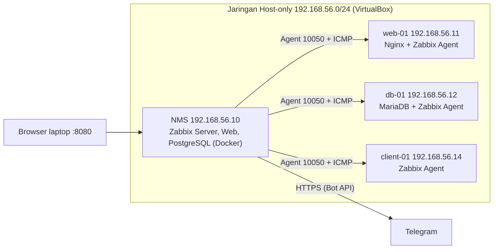

| VM | Peran | IP (Host-only) | RAM | CPU | Disk |
|---|---|---|---|---|---|
| NMS-ZABBIX | Zabbix Server + Web + PostgreSQL (Docker) | 192.168.56.10 | 3 GB | 2 | 25 GB |
| WEB-01 | Web server (Nginx) | 192.168.56.11 | 1 GB | 1 | 25 GB |
| DB-01 | Database (MariaDB) | 192.168.56.12 | 1,5 GB | 1 | 25 GB |
| CLIENT-01 | Klien uji | 192.168.56.14 | 1 GB | 1 | 25 GB |

Setiap VM memiliki dua adapter: **NAT** (internet) dan **Host-only** (jaringan lab dan akses web Zabbix dari laptop).

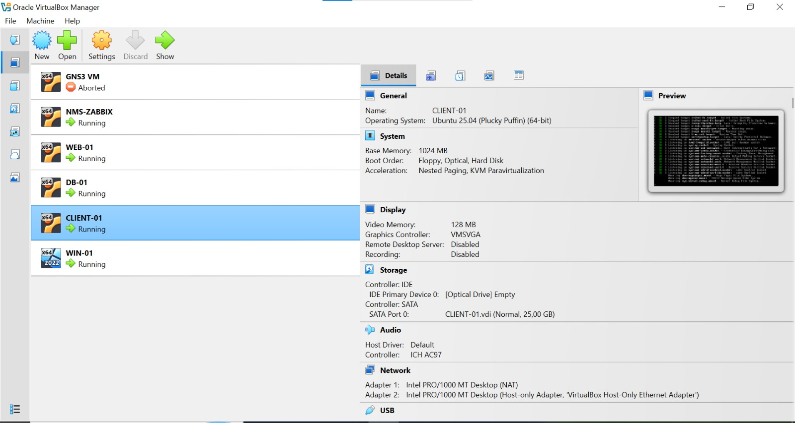
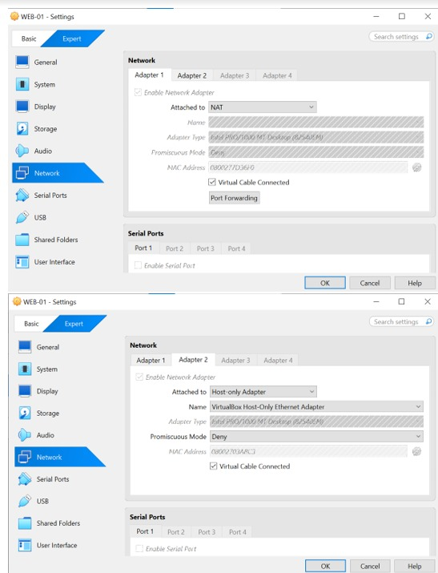
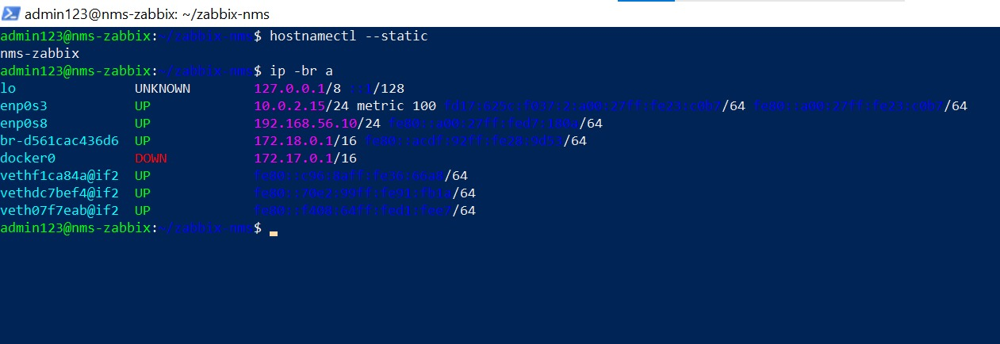

## Teknologi

Oracle VirtualBox, Ubuntu Server 26.04 LTS, Docker dan Docker Compose, Zabbix 7.0 LTS, PostgreSQL 16, Zabbix Agent (paket `zabbix-agent` dari repositori Ubuntu), Nginx, MariaDB, Telegram Bot API.

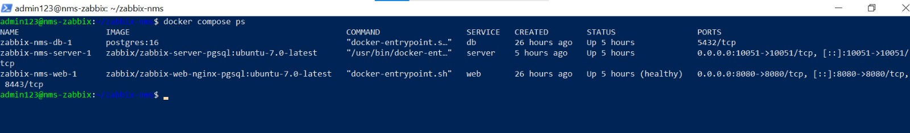
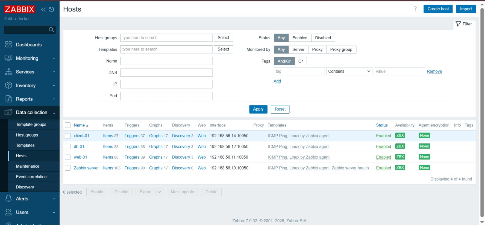

## Yang dipantau

| Aspek | Metode | Trigger | Severity |
|---|---|---|---|
| Ketersediaan host | ICMP Ping dari NMS ke tiap VM (template *ICMP Ping*) | Unavailable by ICMP ping (3 ping gagal berturut-turut) | High |
| Latency dan packet loss | ICMP Ping | Trigger bawaan template | Bawaan template |
| Agent | Zabbix Agent (pasif, port 10050) | Zabbix agent is not available (3 menit) | Average |
| CPU, RAM, disk, trafik | Template *Linux by Zabbix agent* | Trigger bawaan template | Bawaan template |
| Layanan Nginx | Item `net.tcp.service[http,,80]` tiap 30 detik | **Nginx down** (nilai terakhir = 0) | High |
| Layanan MariaDB | Item `net.tcp.port[127.0.0.1,3306]` tiap 30 detik | **MariaDB down** (nilai terakhir = 0) | High |
| CPU web-01 | Item `system.cpu.util` | **High CPU on web-01**: `avg(/web-01/system.cpu.util,#2)>80` | High |

Catatan: ping dilakukan dari **NMS ke tiap VM**, bukan antar sesama VM.

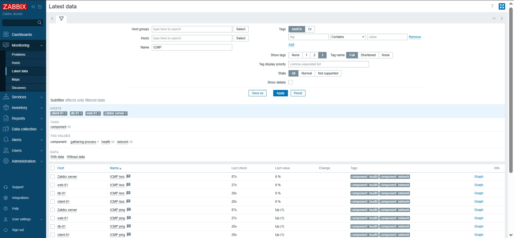
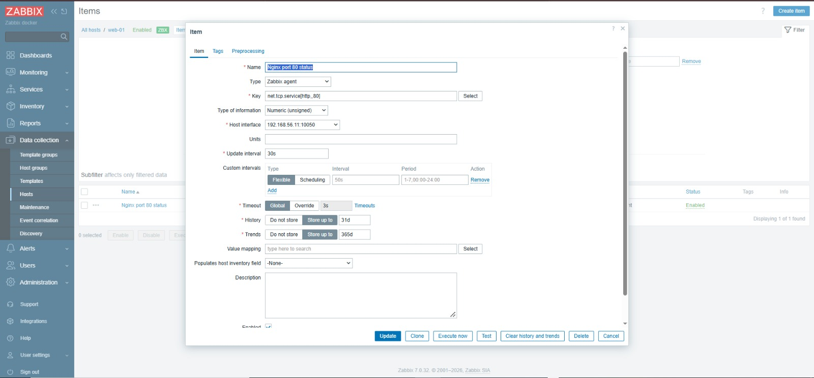
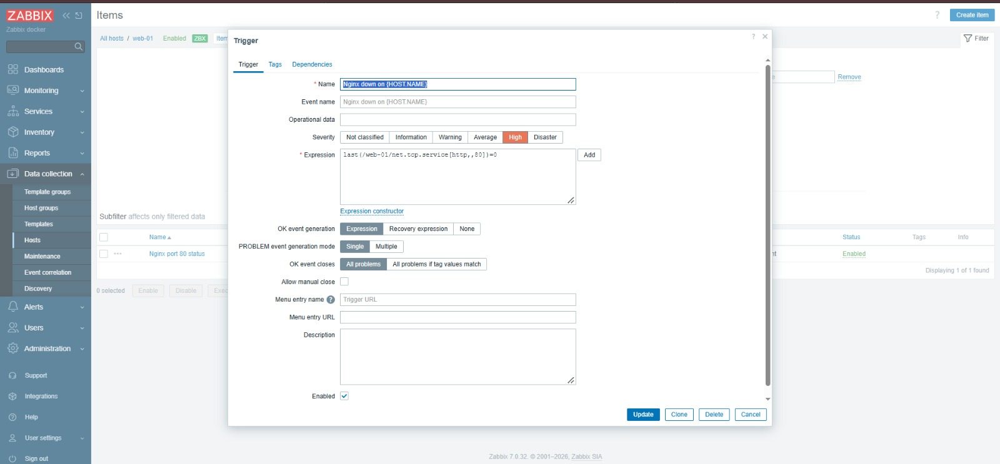

## Alert Telegram

Alur: **Trigger → Action → Media type Telegram → Bot → HP**.
Action memiliki syarat *severity Average atau lebih* supaya peringatan kecil tidak membanjiri notifikasi, dan memiliki *Recovery operation* sehingga pesan **Resolved** ikut terkirim.

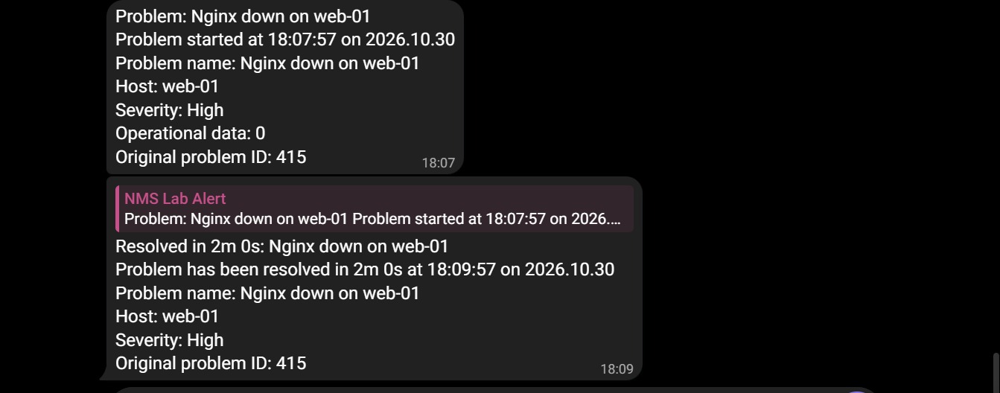
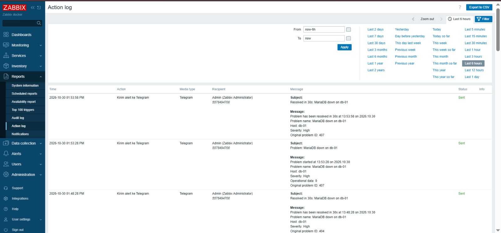
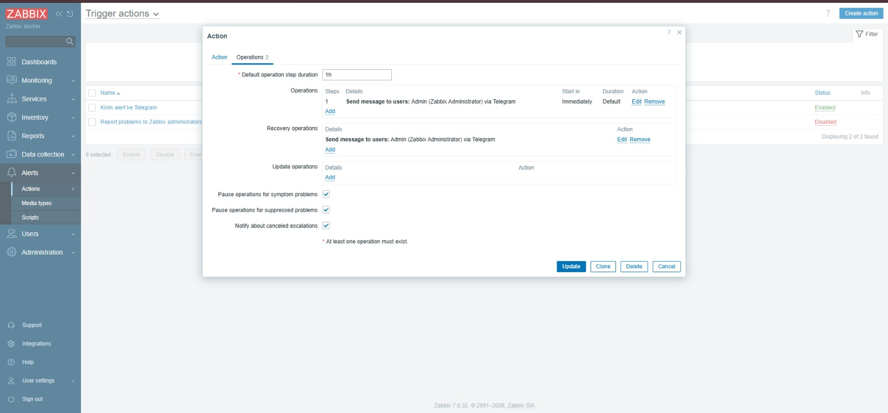

## Uji insiden

Waktu dalam WIB. Durasi adalah lama masalah terlihat oleh Zabbix. Waktu deteksi bergantung pada interval pengecekan (30 detik untuk layanan; ICMP memerlukan 3 kegagalan berturut-turut sehingga sekitar 2-3 menit).

| # | Skenario | Host | Alert muncul | Pulih | Durasi | Severity | Notifikasi |
|---|---|---|---|---|---|---|---|
| 1 | `systemctl stop nginx` | web-01 | 29 Okt 18:02:57 | 18:04:27 | 1m 30s | High | Web Zabbix |
| 2 | `systemctl stop mariadb` | db-01 | 29 Okt 18:18:58 | 18:20:28 | 1m 30s | High | Web Zabbix |
| 3 | `systemctl stop nginx` | web-01 | 29 Okt 18:49:27 | 18:50:57 | 1m 30s | High | Telegram |
| 4 | `systemctl stop mariadb` | db-01 | 29 Okt 18:52:28 | 18:54:58 | 2m 30s | High | Telegram |
| 5 | `systemctl stop nginx` | web-01 | 30 Okt 12:40:57 | 12:41:57 | 1m 0s | High | Telegram |
| 6 | VM dimatikan (`poweroff`) | client-01 | 30 Okt 13:00:33 (ICMP) dan 13:01:44 (agent) | 01:07:33 | 7m | High dan Average | Telegram |
| 7 | Beban CPU 4 menit | web-01 | 01:29:17 | 01:36:17 | 7m | High | Telegram |

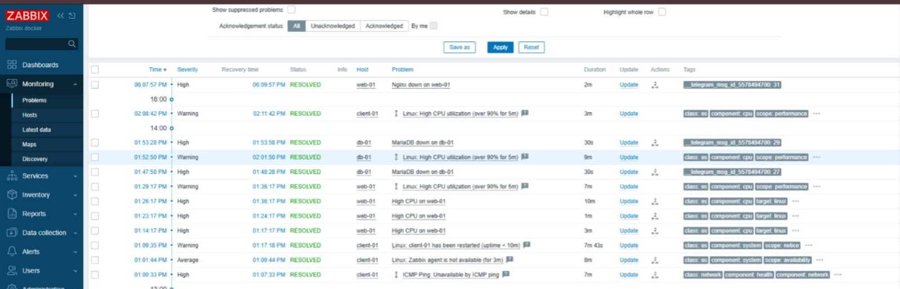
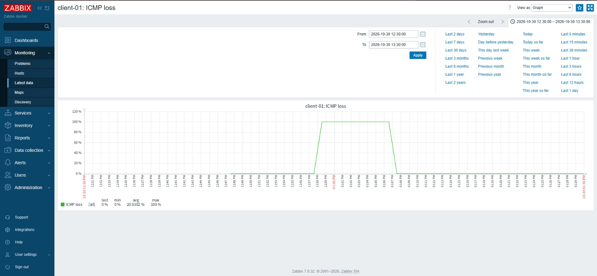
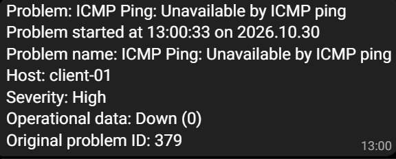
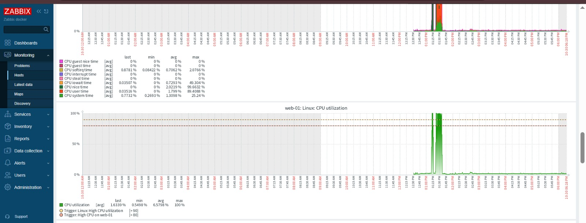
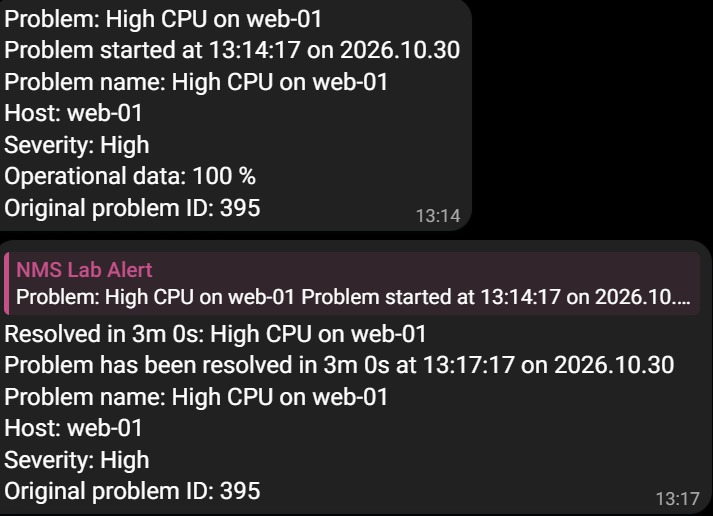

## Network map dan dashboard NOC

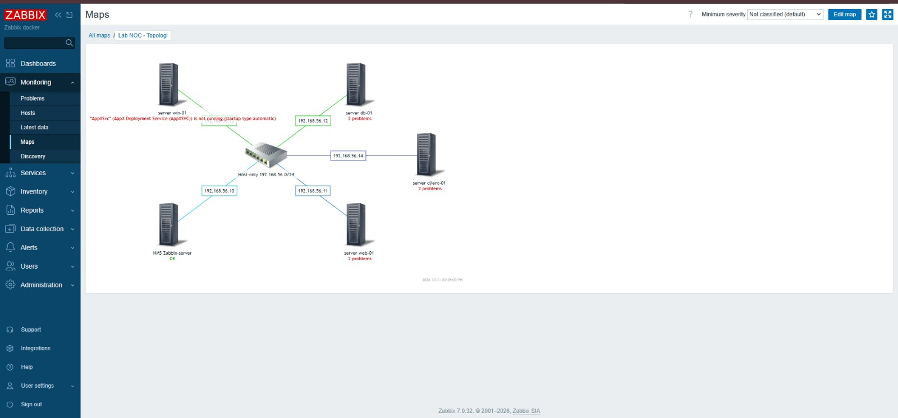
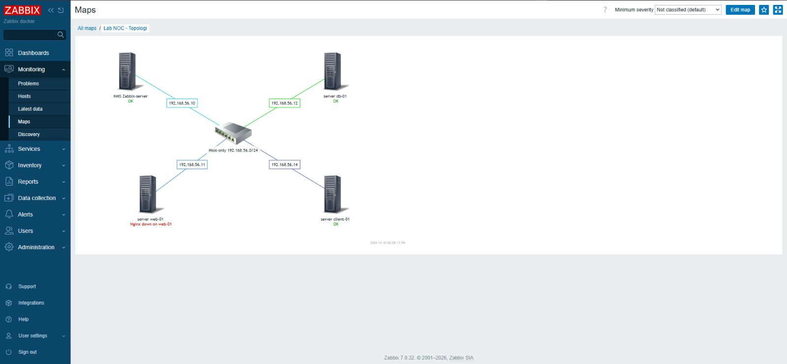
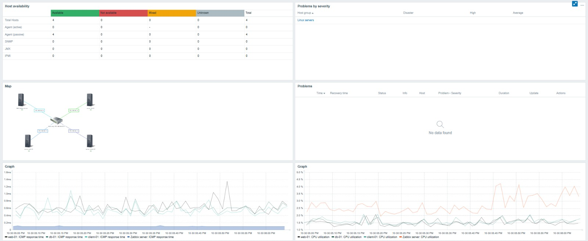
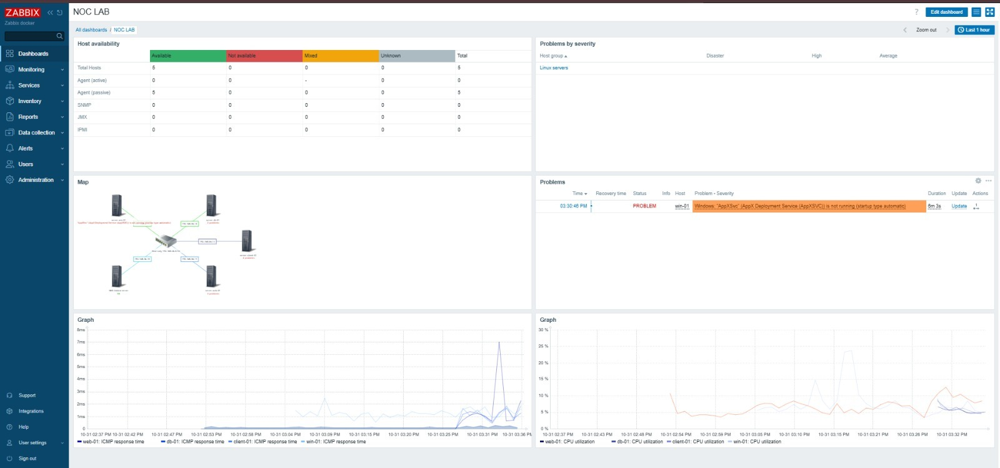

## Kendala dan solusi

| Kendala | Penyebab | Solusi |
|---|---|---|
| Instalasi Ubuntu Server 26.04 gagal di langkah *installing kernel* (apt exit code 100) | Unduhan paket lewat jaringan NAT gagal | Instal dengan kabel jaringan VM dilepas (kernel diambil dari ISO), jaringan diaktifkan setelah instalasi |
| VM tanpa alamat IPv4 setelah instalasi offline | Tidak ada konfigurasi netplan | Atur IP dengan `netplan set` |
| `netplan apply` menolak file karena indentasi YAML | Kesalahan ketik pada file YAML | Pakai `netplan set` sehingga tidak perlu menulis YAML manual |
| Dua VM berbagi IP setelah *clone* | Clone mewarisi konfigurasi jaringan | Hapus alamat lama, set alamat baru, buat ulang `machine-id` dan kunci SSH host |
| Host "Zabbix server" tidak tersedia | Server berjalan di container, sehingga `127.0.0.1` adalah container itu sendiri | Arahkan interface ke IP VM dan izinkan subnet Docker pada parameter `Server` agent |
| Peringatan SSH *REMOTE HOST IDENTIFICATION HAS CHANGED* | Alamat IP dipakai VM lain | `ssh-keygen -R <ip>` |
| Tes media type Telegram gagal (`event_source`) | Macro tidak terisi di dialog Test | Isi nilai uji manual, lalu uji dengan alert nyata |
| Jam pesan Telegram (UTC) berbeda dari web Zabbix (WIB) | Container server memakai UTC | Ubah zona waktu VM dan mount `/etc/localtime` ke container server |
| `docker compose up` gagal setelah menambah file override | Nama service di file override tidak sama dengan file utama | Cek nama dengan `docker compose config --services` |

## Keamanan

- Token bot Telegram hanya tersimpan di Zabbix, tidak ada di repositori.
- File `.env` masuk `.gitignore`. Gunakan `.env.example` sebagai contoh.
- Jaringan lab bersifat Host-only (tidak terpapar ke luar laptop).
- Agent hanya menerima permintaan dari alamat Zabbix server (parameter `Server`).
- Password bawaan akun `Admin` Zabbix wajib diganti setelah login pertama.

## Cara mereplikasi (ringkas)

1. Buat 4 VM Ubuntu Server dengan adapter NAT dan Host-only, atur IP static sesuai tabel.
2. Di VM NMS: pasang Docker (`docker.io`, `docker-compose-v2`), lalu:
   ```bash
   cd compose
   cp ../.env.example .env   # isi DB_PASS
   docker compose up -d
   ```
3. Buka `http://192.168.56.10:8080`, login `Admin` dengan password bawaan Zabbix, lalu segera ganti.
4. Pasang `zabbix-agent` di tiap VM, atur `Server=` dan `Hostname=` pada `/etc/zabbix/zabbix_agentd.conf`.
5. Tambahkan host, tempelkan template *Linux by Zabbix agent* dan *ICMP Ping*, lalu buat item dan trigger sesuai tabel di atas.
6. Telegram: buat bot lewat BotFather, isi token di media type Telegram, daftarkan chat ID pada media user, lalu buat action.

## Rencana pengembangan

- Menambah **Windows Server** sebagai VM ke-5 agar lingkungan multi-OS.
- *Trigger dependency* agar satu gangguan tidak menghasilkan dua notifikasi.
- Pemantauan perangkat jaringan lewat **SNMP**.
- Laporan ketersediaan (SLA report) per host.

## Penulis
CAHAYA JAYA PRABASA| LinkedIn:https://www.linkedin.com/in/cahaya-jaya-prabasa | Email: cahayaprabasa@gmail.com
